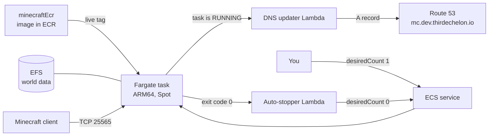

# minecraft

A private Minecraft Java Edition server on AWS. The server runs as an ECS Fargate task. You start the server with one command. The server stops automatically after 30 minutes with no players.

Server address: `mc.dev.thirdechelon.io`

## Contents

| Directory          | Contents                                                                                          |
| ------------------ | ------------------------------------------------------------------------------------------------- |
| `minecraftEcr/`    | A CDK app. It builds the server image and publishes it to Amazon ECR.                             |
| `minecraftServer/` | A CDK app. It makes the network, the world storage, the ECS service and two AWS Lambda functions. |

Each directory is a separate CDK app. Each app has its own `package.json`, tests and `README.md`.

## How the system works



1. `minecraftEcr` builds the image from `itzg/minecraft-server`. It publishes two tags: a version tag (for example, `26.3-r2`) and `live`.
2. You set the desired count of the ECS service to 1. ECS starts one task on Fargate Spot.
3. The task pulls the `live` image. The task mounts the world from Amazon EFS.
4. When the task is RUNNING, EventBridge starts the DNS updater Lambda function. The function writes the public IP address of the task to `mc.dev.thirdechelon.io`.
5. Players connect on TCP port 25565. Only players on the whitelist can join.
6. After 30 minutes with no players, the server stops. The container exits with code 0.
7. EventBridge starts the auto-stopper Lambda function. The function sets the desired count to 0. ECS does not start a new task.

The world stays on EFS when the server stops. AWS Backup makes a backup of the world each day.

## Prerequisites

- An AWS account with the CDK bootstrap complete in Region `us-east-1`. The CDK deploys to the account of your AWS credentials.
- A Route 53 hosted zone. This project uses `dev.thirdechelon.io`. You must use a hosted zone that you own. Set `zoneName` and `recordName` in `minecraftServer/cdk.json` to your hosted zone and server address. The SSM parameter `/minecraft/dns/hosted-zone-id` must contain the ID of your hosted zone. To make the parameter, use this command (replace `<hosted-zone-id>` with the ID):

  ```bash
  aws ssm put-parameter --name /minecraft/dns/hosted-zone-id --type String --value <hosted-zone-id>
  ```

- Node.js 20 or later. Before January 2027, upgrade to Node.js 22 or later. New AWS SDK releases after that date need Node.js 22.
- Docker with buildx. Docker is necessary to deploy `minecraftEcr`. Tests and synth do not need Docker.
- The AWS CLI and the Session Manager plugin. These are necessary to operate the server.
- A Minecraft Java Edition client at the same version as the server (now 26.3).

## Deploy

TeamCity deploys the two apps. Each app has two configurations:

| Configuration  | Location in TeamCity           | Starts                     |
| -------------- | ------------------------------ | -------------------------- |
| `<app> CI`     | Builds → minecraft             | On each push to any branch |
| `<app> Deploy` | Environments → Dev → minecraft | Only when you start it     |

Each configuration does `npm ci`. Then it does `npx tsc && npm run format:check && npx jest --ci --runInBand`. The CI configuration then does `cdk synth`. The Deploy configuration then does `cdk deploy`.

Deploy the apps in this sequence:

1. Run `minecraftEcr Deploy`.
2. Run `minecraftServer Deploy`.

`minecraftServer` reads the ECR repository name from the SSM parameter `/minecraft/ecr/repository-name`. `minecraftEcr` makes this parameter. If `minecraftEcr` is not deployed, the deploy of `minecraftServer` fails.

## Operate the server

Do all the steps in this section in one terminal.

1. Set the AWS credentials:

   ```bash
   awsume devAdmin
   ```

2. Find the cluster name and the service name:

   ```bash
   clusterName=$(aws ssm get-parameter --name /minecraft/server/cluster-name --query Parameter.Value --output text)
   serviceName=$(aws ssm get-parameter --name /minecraft/server/service-name --query Parameter.Value --output text)
   ```

### Start the server

1. Set the desired count to 1:

   ```bash
   aws ecs update-service --cluster "$clusterName" --service "$serviceName" --desired-count 1 --query service.desiredCount
   ```

2. Wait 1 to 3 minutes.
3. In Minecraft, select **Multiplayer → Direct Connection**.
4. Enter `mc.dev.thirdechelon.io`.

### Stop the server

The server stops automatically after 30 minutes with no players. To stop the server immediately, set the desired count to 0:

```bash
aws ecs update-service --cluster "$clusterName" --service "$serviceName" --desired-count 0 --query service.desiredCount
```

The server saves the world before it stops.

### Restart the server with the newest image

```bash
aws ecs update-service --cluster "$clusterName" --service "$serviceName" --force-new-deployment
```

### Run server commands

1. Find the task:

   ```bash
   taskArn=$(aws ecs list-tasks --cluster "$clusterName" --service-name "$serviceName" --query "taskArns[0]" --output text)
   ```

2. Open the server console:

   ```bash
   aws ecs execute-command --cluster "$clusterName" --task "$taskArn" --container server --interactive --command "rcon-cli"
   ```

3. Enter a server command. For example: `list`, `whitelist add <name>`, `op <name>` or `save-all`.
4. Enter `exit` to close the console.

To pause auto-stop (for example, for an AFK farm), make the file `/data/.skip-stop`:

```bash
aws ecs execute-command --cluster "$clusterName" --task "$taskArn" --container server --interactive --command "touch /data/.skip-stop"
```

To start auto-stop again, remove the file:

```bash
aws ecs execute-command --cluster "$clusterName" --task "$taskArn" --container server --interactive --command "rm /data/.skip-stop"
```

## Change the server

> **CAUTION:** Increase `imageRevision` in `minecraftEcr/cdk.json` for each change to the image. Version tags are immutable. If you use the same revision again, the deploy fails.

> **CAUTION:** Do not decrease `minecraftVersion`. An older version cannot load a world that a newer version opened. Before you upgrade, make sure that a recent backup exists.

| To change                             | Edit                                                             | Then                                                                 |
| ------------------------------------- | ---------------------------------------------------------------- | -------------------------------------------------------------------- |
| Game settings, whitelist or operators | `minecraftEcr/docker/Dockerfile`                                 | Increase `imageRevision`. Deploy `minecraftEcr`. Restart the server. |
| Minecraft version                     | `minecraftVersion` and `itzgImageTag` in `minecraftEcr/cdk.json` | Increase `imageRevision`. Deploy `minecraftEcr`. Restart the server. |
| Spot or on-demand capacity            | `spot` in `minecraftServer/cdk.json`                             | Deploy `minecraftServer`.                                            |

## Develop

Do these commands in `minecraftEcr/` or in `minecraftServer/`:

```bash
npm ci                 # Install the exact dependency versions
npm run format         # Format the code with Prettier
npx tsc                # Check the types
npm run format:check   # Make sure that the format is correct
npx jest               # Run the tests
npx cdk synth --quiet  # Make the CloudFormation templates in cdk.out/
```

Prettier controls the code format (`.prettierrc.json`): no semicolons, single quotes and a maximum of 100 characters on each line. TeamCity rejects code that Prettier did not format.

Tests and synth do not need AWS credentials. The stack sets the Availability Zones (`us-east-1a` and `us-east-1b`). Thus, synth does not send queries to AWS.

## Cost

The task costs money only while it runs. These are approximate costs in `us-east-1` for 2 vCPU, 8 GB and ARM64:

|                                           | Spot                | On-demand           |
| ----------------------------------------- | ------------------- | ------------------- |
| Each hour that the server runs            | approximately $0.03 | approximately $0.09 |
| 4 hours each day for one month, all costs | approximately $7    | approximately $14   |

When the server is stopped, storage, backups, images and logs cost approximately $1 to $6 each month.

All resources have the tag `project=minecraft`. To see these costs in Cost Explorer, activate this tag as a cost allocation tag in the Billing console.

## Security

- Only TCP port 25565 is open to the internet.
- Online mode and the whitelist are on. Only Minecraft accounts on the whitelist can join.
- RCON is not open to the internet. Use ECS Exec (`rcon-cli`) for server commands. ECS Exec needs AWS credentials.
- The DNS updater can change only one record: the A record `mc.dev.thirdechelon.io`.

## Delete the system

> **CAUTION:** The EFS file system and the ECR repository have the removal policy RETAIN. When you delete a stack, these resources stay. If you do not need the world or the images, delete them manually.

Both stacks have termination protection. Disable termination protection before you delete a stack.
