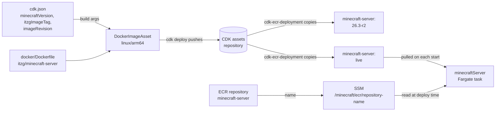

# minecraftEcr

CDK app that owns the Minecraft server's container image. It creates the ECR repository
`minecraft-server`, builds the image from `docker/Dockerfile`, and publishes it under two tags:

| Tag                                                    | Moves?            | Purpose                                  |
| ------------------------------------------------------ | ----------------- | ---------------------------------------- |
| `<minecraftVersion>-r<imageRevision>` (e.g. `26.3-r1`) | Never (immutable) | History and rollback                     |
| `live`                                                 | Every publish     | The tag the ECS task pulls on each start |

The repository name is published to SSM at `/minecraft/ecr/repository-name`, which
`minecraftServer` reads at deploy time. **Deploy this app before `minecraftServer`.**

## How it works



1. `cdk deploy` builds the image from `docker/Dockerfile` for `linux/arm64`. The `cdk.json` values are passed in as build args.
2. The CDK pushes the built image to its own bootstrap assets repository.
3. `cdk-ecr-deployment` copies the image into `minecraft-server` twice: once as the version tag, once as `live`.
4. The repository name goes to SSM, where `minecraftServer` reads it. Each new server task pulls `live`, so a restart picks up the new image.

## Layout

```
bin/minecraft_ecr.ts                          entry point (env, termination protection, project=minecraft tag)
lib/minecraft_ecr-stack.ts                    MinecraftEcrStack
lib/constructs/minecraft-image-repository.ts  ECR repo: immutable tags except `live`, lifecycle rules, RETAIN
lib/constructs/minecraft-image-publisher.ts   DockerImageAsset (arm64) → cdk-ecr-deployment copies to both tags
docker/Dockerfile                             itzg/minecraft-server + server settings as ENV
test/                                         Jest assertions on the synthesized template
```

## Configuration (`cdk.json` context)

| Key                | Example           | Notes                                                                                                                                    |
| ------------------ | ----------------- | ---------------------------------------------------------------------------------------------------------------------------------------- |
| `minecraftVersion` | `26.3`            | Never downgrade: a world opened by a newer version won't load in an older one                                                            |
| `itzgImageTag`     | `2026.9.2-java25` | Pinned itzg release; 26.x needs a `java25` tag                                                                                           |
| `imageRevision`    | `1`               | **Bump on every image change** (Dockerfile edit or version bump). Reusing a revision fails the deploy because version tags are immutable |

## Commands

```bash
npm ci                 # install exactly what package-lock.json specifies
npx tsc                # type-check
npx jest               # run tests
npx cdk synth --quiet  # write templates to cdk.out/ (no AWS credentials or Docker needed)
```
